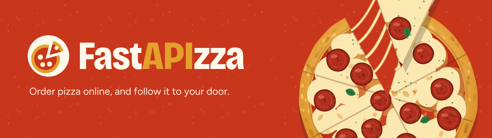
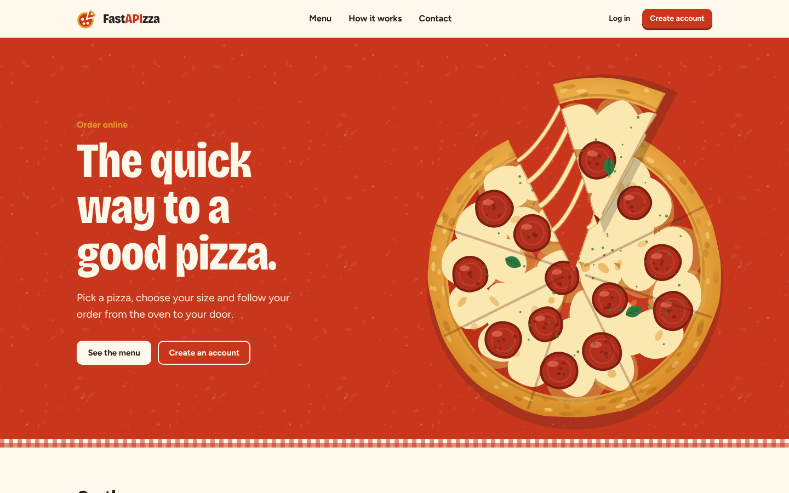
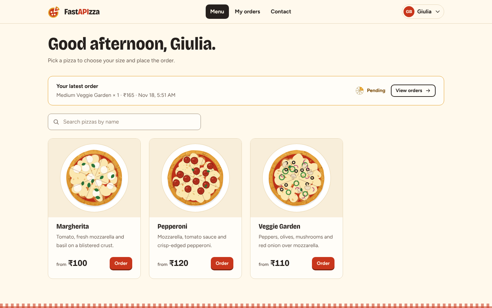
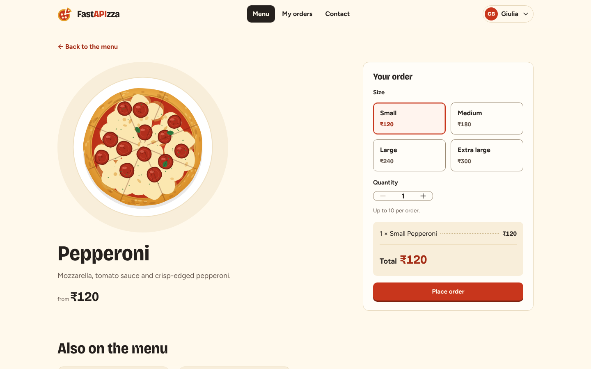
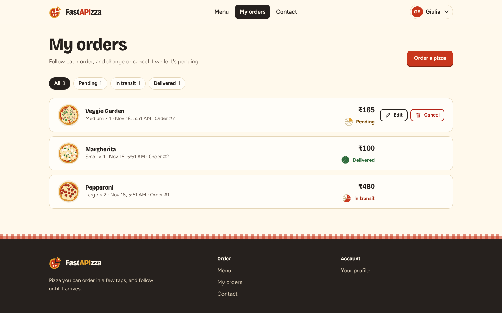
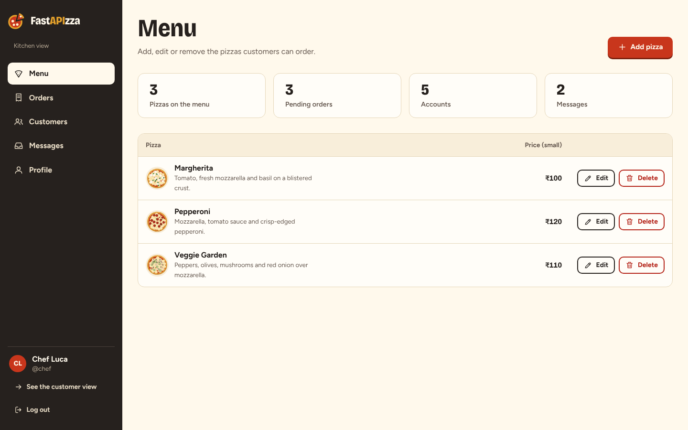
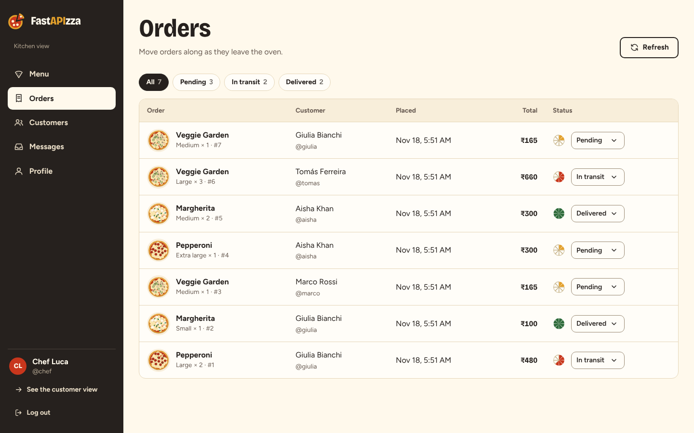
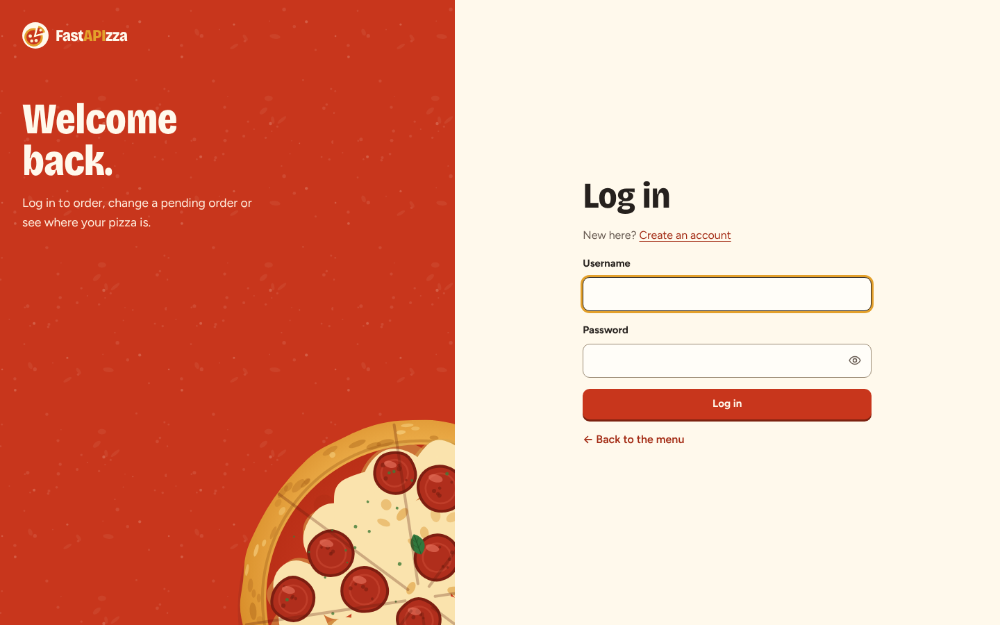
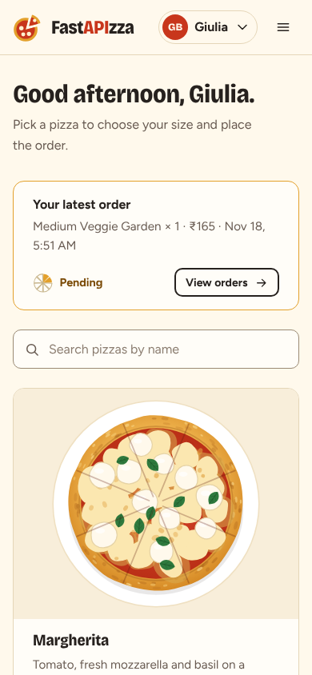

<div align="center">



# FastAPIzza

**Order pizza online, and follow it to your door.**

[](https://www.python.org/)
[](https://fastapi.tiangolo.com/)
[](https://www.sqlalchemy.org/)
[](https://www.postgresql.org/)
[](LICENSE)

</div>

---

## Overview

FastAPIzza is a pizza ordering application with two sides, like a real restaurant:

- **Front of house.** Customers browse the menu, pick a size and quantity, place an order and watch it move from the oven to their door.
- **The kitchen.** Staff manage the menu, move orders along, see who has signed up and read messages from the contact form.

It is a FastAPI backend serving a JSON API and server-rendered page shells, with a dependency-free JavaScript front end (ES modules, no build step).

## Key features

**Customers**

- Browse the menu, search by name, and see the starting price of every pizza.
- Choose a size and quantity; the total updates live before the order is placed.
- Follow each order through **Pending → In transit → Delivered**.
- Edit or cancel an order while it is still pending.
- Edit profile details and profile photo; see real order totals.
- Send a message to the restaurant through the contact form.

**Staff**

- Add, edit and delete pizzas, with an optional photo.
- See all orders, filter by status and change an order's status.
- List all accounts with their role and order count.
- Read and delete contact messages.
- Staff accounts are created by an operator script, never through public sign-up.

## Technology stack

| Layer | Technology |
| --- | --- |
| Backend | FastAPI, Starlette, Pydantic v2 |
| Data | SQLAlchemy 2 (PostgreSQL via `psycopg2`, or SQLite for local use) |
| Auth | JWT access and refresh tokens (PyJWT), salted password hashes (Werkzeug) |
| Pages | Jinja2 templates |
| Front end | Vanilla JavaScript (ES modules), hand-written CSS design system |
| Typography | Bricolage Grotesque and Figtree, self-hosted (SIL OFL) |
| Tests | pytest with FastAPI's test client |

## Architecture

```
Browser ── HTML pages (Jinja2 shells)  ──▶  app/routers/pages.py
   │
   └────── fetch() JSON + multipart ───▶  app/routers/{auth,pizzas,orders,contact}.py
                                              │
                         security.py (JWT, roles) · uploads.py (image checks)
                                              │
                                      SQLAlchemy models ──▶ PostgreSQL / SQLite
```

- Pages are thin shells. Each page script loads its own data from the API and guards access by role.
- The API is the source of truth for permissions. The front-end guards only decide which screen to show.
- Order prices are calculated on the server from the pizza's listed price and a size multiplier. The unit price is stored on the order, so history stays correct if the menu changes.

## Project structure

```
FastAPIzza/
├── app/
│   ├── main.py            # app setup, security headers, error pages
│   ├── config.py          # environment-driven settings
│   ├── database.py        # engine, sessions
│   ├── models.py          # User, Pizza, Order, ContactMessage
│   ├── schemas.py         # request/response models
│   ├── security.py        # tokens, current-user and staff dependencies
│   ├── uploads.py         # image validation and storage
│   ├── ratelimit.py       # small in-process rate limiter
│   ├── routers/           # auth, pizzas, orders, contact, pages
│   ├── templates/         # base layout, shells, one template per page
│   └── static/
│       ├── css/           # design system and page styles
│       ├── js/            # core module, menu/contact helpers, one script per page
│       ├── img/           # logo, favicons, pizza illustrations
│       └── fonts/         # self-hosted variable fonts and licence
├── scripts/               # init_db (tables, optional starter menu), create_admin
├── tests/                 # API, permission and page tests
├── docs/                  # banner and screenshots
├── requirements.txt
├── requirements-dev.txt
└── .env.example
```

## Screenshots

| | |
| :-- | :-- |
|  |  |
| **Landing.** A pepperoni pizza with a slice lifted away. | **Menu.** Search and order from the dashboard. |
|  |  |
| **Ordering.** Size, quantity and a live receipt. | **Orders.** Status shown as slices of a pizza. |
|  |  |
| **Kitchen: menu.** Add, edit and remove pizzas. | **Kitchen: orders.** Move orders through each stage. |
|  |  |
| **Log in.** | **Mobile.** The same menu on a phone. |

## UI/UX highlights

- **One idea, used consistently.** Pizza is the design language, not a theme painted on top. Order status is a pizza cut into eight, and the number of filled slices shows progress. The loader is a pizza whose gold slice steps around the circle. Receipts use dotted leaders like a printed menu.
- **Front of house and the kitchen.** Customer pages are cream and tomato; staff pages use a charcoal sidebar so the two roles feel different at a glance.
- **Illustrations drawn for the product.** The logo, pizzas, empty-state box and texture are original SVG artwork. There are no stock photos.
- **Considered type.** Bricolage Grotesque for headings and prices, Figtree for interface text, both self-hosted.
- **Every state is designed.** Loading skeletons, empty states, inline validation, error states with retry, success toasts and confirmation dialogs for destructive actions.
- **Accessible by default.** Visible labels, keyboard-friendly dialogs and menus, focus rings, a skip link, live regions for results, a palette chosen for readable contrast, and `prefers-reduced-motion` respected.
- **Responsive.** Layouts were checked at phone, tablet and desktop widths; tables become stacked rows on small screens and the staff sidebar becomes a drawer.

## Security and implementation notes

- **Roles.** Public sign-up always creates a customer. Staff-only routes check the role on the server.
- **Ownership.** Customers can only read, edit or cancel their own orders, and only while pending. Another customer's order id returns "not found".
- **Passwords and tokens.** Passwords are stored as salted hashes. Access and refresh tokens are separate types and cannot be swapped. Tokens identify users by id, so changing a username does not break a session. Login attempts are rate limited, and unknown usernames are checked against a dummy hash so response times stay similar.
- **Secrets.** No secrets live in the source. The signing key comes from the environment; if it is missing the app generates a temporary one and logs a warning.
- **Uploads.** Image type is detected from the file's bytes (PNG, JPEG, WebP, GIF), not the file name. Files get random names, have a size limit, and SVG is not accepted.
- **Output safety.** The front end builds the page with DOM APIs, never HTML strings, so names and descriptions cannot inject markup. A strict Content Security Policy (own origin only, no inline scripts or styles) backs this up, alongside `X-Frame-Options`, `nosniff` and a referrer policy.
- **Contact form.** Honeypot field plus a per-address rate limit.
- **Time.** Timestamps are stored and returned in UTC.

**Known limitations**

- Logout clears the tokens in the browser. Tokens are stateless, so there is no server-side revocation before they expire.
- Rate limiting is in-process. With several workers, enforce limits at the proxy or use a shared store.
- Tables are created at startup. There is no migration tool, so schema changes need one before production use.
- Uploaded images are stored on local disk.
- Tokens are kept in `localStorage`; the CSP and DOM-only rendering reduce, but do not remove, the exposure that comes with that choice.
- There are no payments, email notifications or live location tracking; "In transit" is a status staff set by hand.

## Verification

The automated suite (59 tests) covers sign-up, login and token flows, role and ownership rules, order pricing and lifecycle, menu management, upload validation, the contact form, rendering of every page and security headers. It was run against both SQLite and PostgreSQL 16.

In a real browser (Chromium), a scripted walkthrough covered sign-up, search, ordering, editing and cancelling an order, profile changes, the contact form, staff menu and order management, and role redirects. Every page was also loaded at 390, 768 and 1440 px with the CSP enforced, checking for console errors and horizontal overflow.

Not tested: a production deployment behind a reverse proxy, multiple worker processes, and browsers other than Chromium.

## Future improvements

- Database migrations.
- Server-side session revocation and a "log out everywhere" option.
- Staff controls to disable or re-enable accounts (the field exists and is enforced at login).
- Email notifications when an order changes status.
- Optional toppings and per-pizza size pricing.


